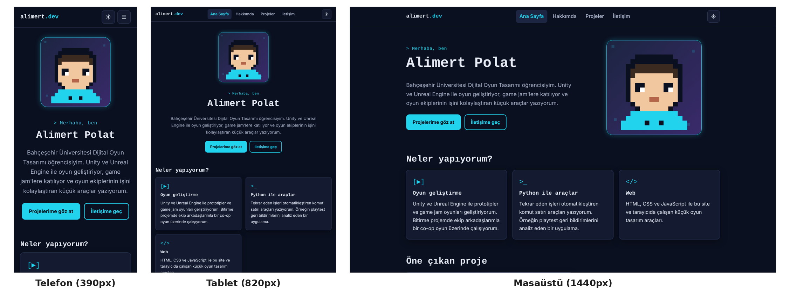

# alimert.dev: Kişisel Portfolyo

**🔗 Canlı site: https://almpolat.github.io**

Alimert Polat (Bahçeşehir Üniversitesi, Dijital Oyun Tasarımı) için HTML, CSS ve JavaScript ile yazılmış, GitHub Pages'te yayınlanan 4 sayfalık portfolyo sitesi.

**GEP1316 Kodlama Okuryazarlığı · Ara Değerlendirme Ödevi 2**



## Sayfalar

| Sayfa | İçerik |
|---|---|
| [Ana Sayfa](https://almpolat.github.io/) | Tanıtım, piksel sanatı avatar, "Neler yapıyorum?" kartları, öne çıkan proje |
| [Hakkımda](https://almpolat.github.io/hakkimda.html) | Eğitim, ilgi alanları, "Kodlama ve YZ'nin mesleğimdeki yeri" |
| [Projeler](https://almpolat.github.io/projeler.html) | 4 proje kartı, filtreleme ve arama |
| [İletişim](https://almpolat.github.io/iletisim.html) | Doğrulamalı form, gizlilik notu, GitHub bağlantısı |

### Projeler

| Proje | Tür | Bağlantı |
|---|---|---|
| Playtest Geri Bildirim Analizcisi | Python | [Depo](https://github.com/almpolat/playtest-analizci) |
| Oyun Fikri Üreteci | Web (JS) | [Dene](https://almpolat.github.io/projeler/oyun-fikri.html) |
| Zar Atıcı | Web (JS) | [Dene](https://almpolat.github.io/projeler/zar.html) |
| Game Jam Geri Sayım | Web (JS) | [Dene](https://almpolat.github.io/projeler/geri-sayim.html) |

## Teknik özellikler

- **Ortak dosyalar:** tüm sayfalar tek `style.css` ve tek `script.js` kullanır.
- **Duyarlı tasarım:** 2 `@media` kuralı. 900px altı tablet düzeni (2 sütun), 640px altı telefon düzeni (1 sütun, açılır menü).
- **JavaScript etkileşimleri:**
  1. Karanlık/açık tema (ilk açılışta sistem temasına uyar, tercih hatırlanır)
  2. Mobil menü (Esc ile kapanır, açılınca odak ilk bağlantıya geçer)
  3. Proje filtreleme (Tümü/Python/Web) ve arama
  4. İletişim formu doğrulama, karakter sayacı ve geri bildirim mesajı
- **Erişilebilirlik:**
  - anlamsal HTML (`header/nav/main/footer`) ve tüm görsellerde `alt` metni
  - tüm form alanlarında `label`, hata mesajlarında `aria-describedby` ve `aria-invalid`
  - "İçeriğe atla" bağlantısı, görünür klavye odağı
  - `prefers-reduced-motion` desteği
  - axe-core taramasında 0 hata
- **Güvenlik ve gizlilik:**
  - İçerik Güvenlik Politikası (CSP)
  - kullanıcı girdisi her yerde `textContent` ile yazılır (`innerHTML` yok)
  - üçüncü taraf script, font, çerez veya izleyici yok
  - e-posta ve telefon yayımlanmaz, form verisi hiçbir yere gönderilmez

## Dosya yapısı

```
index.html  hakkimda.html  projeler.html  iletisim.html
style.css   script.js
img/                 avatar ve proje görselleri (SVG, elle üretildi)
projeler/            3 mini proje (html + js)
ekran_goruntuleri/   test ekran görüntüleri
PROMPTLAR.md         yapay zekâ ile çalışma günlüğü
```

## Yapay zekâ kullanımı

Bu site Claude (Anthropic) ile birlikte geliştirildi. Prompt'lar, kararlar ve YZ'nin hatalarının düzeltilmesi için: [PROMPTLAR.md](PROMPTLAR.md)

> Anthropic. (2026). *Claude* [Büyük dil modeli]. https://claude.ai
